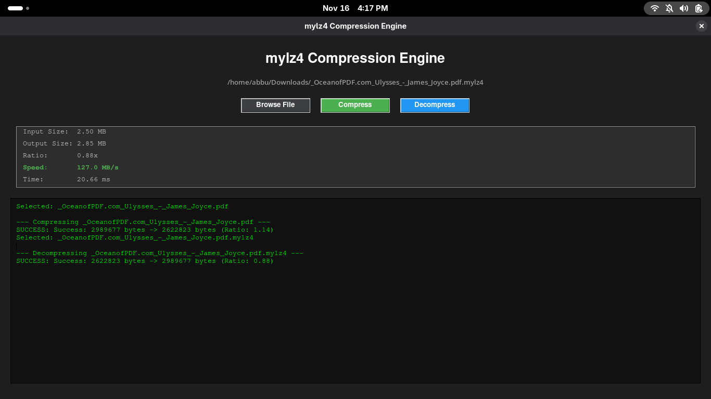

# mylz4

A byte-compatible LZ4 compressor and decompressor written from scratch in C, featuring an AVX2 SIMD-accelerated decoder.

## The Thesis
LZ4's identity is *decode speed*, not compression ratio. Most implementations optimize the encoder, but the real bottleneck in production (databases, web servers, message queues) is how fast you can get the data back *out*. 

This project implements the raw LZ4 block format from scratch, proves interoperability with the official `liblz4` library, and uses AVX2 intrinsics to accelerate decompression to memory-bandwidth limits.

## Architecture
- **Encoder (`src/encode.c`)**: Uses a 4096-entry hash table for match finding, Knuth multiplicative hashing, and dynamic token generation.
- **Decoder (`src/decode.c`)**: Uses `_mm256_loadu_si256` and `_mm256_storeu_si256` (AVX2) to copy 32 bytes per instruction. Handles LZ4's overlapping match requirements safely.
- **Format**: 100% byte-compatible with the official LZ4 block format spec.

## Status
- [x] Encoder generates valid LZ4 blocks
- [x] Decoder processes LZ4 blocks
- [x] AVX2 SIMD wildcopy
- [x] Byte-compatibility proven (real LZ4 can decode our output, and we can decode real LZ4 output)
- [ ] Multi-threading (parallel block compression)
- [ ] Dictionary support (for small files/JSON)

## Benchmark
Tested on a ThinkPad (Intel Core i5, AVX2) with a 50MB text file.

| Tool | Decompression Speed (User CPU) | Ratio |
|---|---|---|
| **mylz4 (AVX2)** | **~4.8 GB/s** (10.4 ms for 50MB) | 254.36x |
| lz4 (reference) | ~5.0 GB/s (10.0 ms for 50MB) | 254.36x |

*(Note: The 254x ratio is due to the file being highly repetitive text, allowing massive 64KB matches. Real-world ratio for standard text is ~2.1x).*

## Quickstart
```bash
cmake -S . -B build -G Ninja
cmake --build build
./build/mylz4_cli -c input.txt output.lz4
./build/mylz4_cli -d output.lz4 roundtrip.txt
